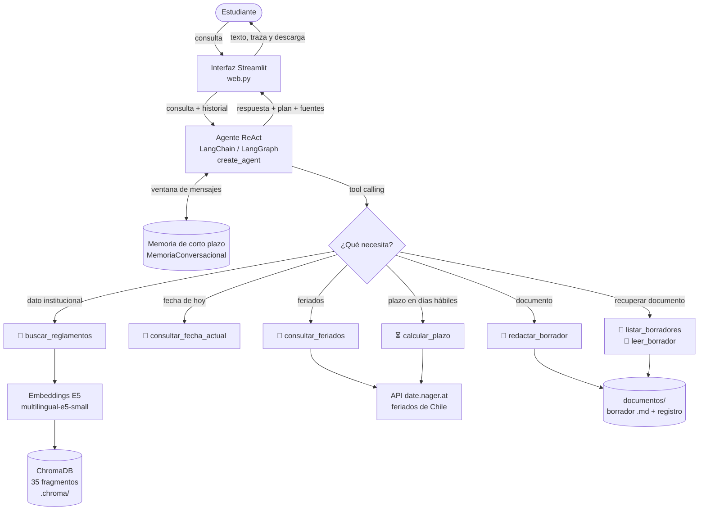
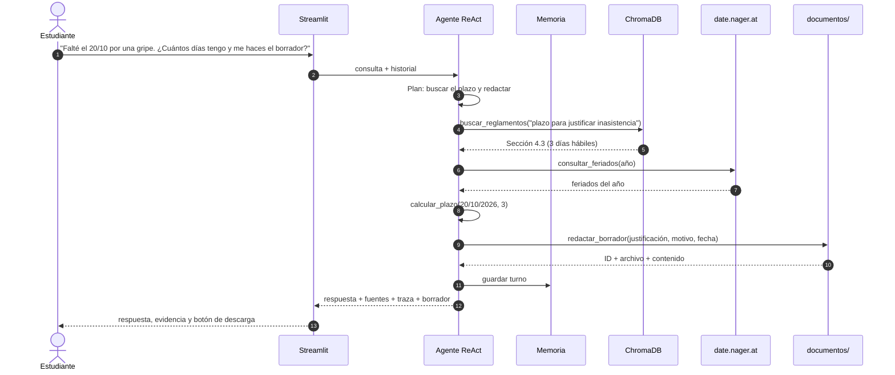
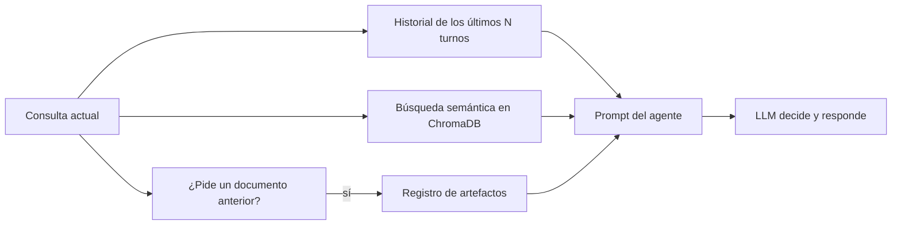
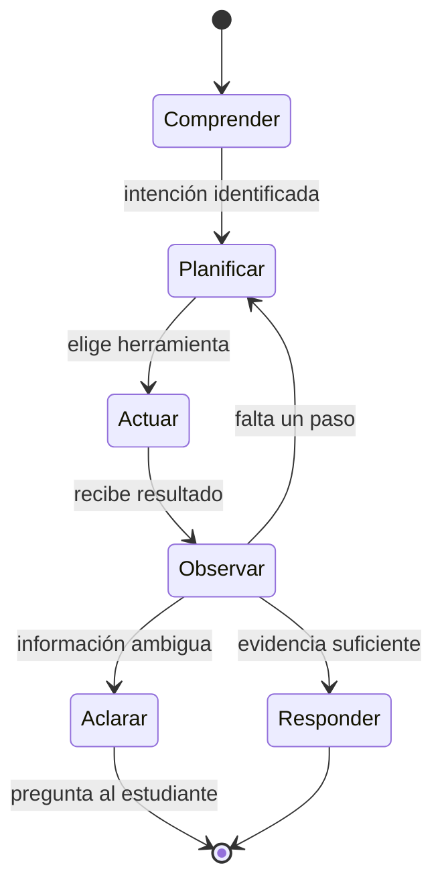

# Duqui · Agente Estudiantil Duoc UC

> **De un RAG léxico a un agente ReAct con herramientas, memoria y recuperación semántica.**
> Proyecto de la asignatura **ISY0101 — Ingeniería de Soluciones con IA**, Evaluación Parcial 2.

[](https://www.python.org/)
[](https://python.langchain.com/)
[](https://www.trychroma.com/)
[](https://streamlit.io/)
[](#licencia)

**Autor:** Benjamín Quiroz
**Asignatura:** ISY0101 — Ingeniería de Soluciones con IA
**Evaluación:** Parcial N.º 2 — Desarrollo de un agente funcional

---

## 1. Qué es este proyecto

Duqui es un asistente conversacional para estudiantes de Duoc UC. Responde
consultas sobre matrícula, calendario académico, becas, evaluaciones,
asistencia, biblioteca, bienestar, práctica, titulación, aranceles, convivencia
y canales de apoyo.

A diferencia de la versión de la Evaluación Parcial 1 —un RAG estático con
búsqueda léxica TF-IDF y un prompt rígido—, esta versión es un **agente
funcional**:

- **Recupera** los reglamentos por **similitud semántica** (embeddings +
  ChromaDB), no por coincidencia de palabras.
- **Decide autónomamente** qué herramienta usar y en qué orden (tool calling).
- **Razona** con un esquema **ReAct**: planifica, actúa, observa el resultado y
  responde; puede encadenar varias herramientas en una misma tarea.
- **Recuerda** la conversación (memoria de corto plazo) y los documentos que ha
  generado (memoria de artefactos).
- **Escribe**: genera borradores formales de justificaciones, solicitudes y
  cartas, los guarda y los deja disponibles para descargar.
- **Calcula plazos** en días hábiles usando feriados reales de Chile.
- **Es empático y flexible**: si la pregunta es ambigua, pide aclaraciones;
  si no encuentra información, lo dice y deriva a la mesa de ayuda.

### Documentación y entregables

| Documento | Formato | Contenido |
|---|---|---|
| [`docs/Informe_Sol-Ia_EvP2_BenjaminQuiroz.pdf`](docs/Informe_Sol-Ia_EvP2_BenjaminQuiroz.pdf) | PDF | **Informe técnico final (EP2)**: justificación arquitectónica, comparativa experimental y reflexiones |
| [`docs/PresentacionSol-IaBenjaminQuiroz.pdf`](docs/PresentacionSol-IaBenjaminQuiroz.pdf) | PDF | **Presentación para la defensa**: diapositivas del proyecto y resumen ejecutivo |
| [`docs/Ev1_SolucionesIA_BenjaminQuiroz.pdf`](docs/Ev1_SolucionesIA_BenjaminQuiroz.pdf) | PDF | **Informe de referencia (EP1)**: entrega previa del RAG léxico con TF-IDF |

---

## 2. Evolución del proyecto: qué se quitó y qué se añadió

### 2.1 Qué se quitó del código anterior (EP1)

* **Eliminación del motor léxico TF-IDF**: Se descartó por completo `scikit-learn` (`TfidfVectorizer`), el conteo estático de frecuencias de palabras, las stopwords manuales y los diccionarios fijos de sinónimos. El modelo léxico fallaba ante variaciones morfológicas y errores tipográficos comunes en consultas de estudiantes.
* **Eliminación del enrutamiento rígido por reglas (`if/elif`)**: En la versión previa, la ejecución de lógica externa dependía de condiciones duras en Python (`if "feriado" in consulta: ...`). Se eliminó para dar paso al razonamiento autónomo del agente mediante *tool calling*.
* **Eliminación del prompt estático de una sola llamada**: Se sustituyó el prompt monolítico sin retroalimentación por un ciclo dinámico ReAct (*Reason + Act + Observe*), donde el modelo evalúa los resultados intermedios de las herramientas antes de elaborar la respuesta final.
* **Depuración de borradores y archivos preliminares en `docs/`**: Se eliminaron de la carpeta `docs/` los borradores de texto intermedios y esquemas desactualizados (`informe_tecnico.md`, `informe_tecnico_EP2.docx`, `informe_tecnico_esquema.md`, `presentacion_5min.pptx`, `presentacion_5min_guion.md`), consolidando la entrega definitiva en los informes oficiales en formato PDF.
* **Limpieza de comentarios y docstrings artificiales**: Se realizó una limpieza profunda de docstrings redundantes y comentarios explicativos tipo tutorial en todos los módulos de `chatbot/` y scripts raíz, dejando una base de código limpia y lista para evaluación.

### 2.2 Qué se añadió de nuevo (EP2)

* **Pipeline RAG Semántico (Embeddings E5 + ChromaDB)**: Indexación vectorial estructurada con `intfloat/multilingual-e5-small` y persistencia local en `.chroma/`, permitiendo encontrar normas ante consultas con erratas o lenguaje coloquial (ej. *"asta cuando puedo retirar un ramo"* encuentra la Sección 2.3).
* **Agente ReAct con LangChain 1.x / LangGraph**: Orquestación autónoma mediante `create_agent` que razona paso a paso, evalúa resultados intermedios y encadena herramientas en tareas complejas multi-etapa.
* **7 Herramientas del Agente**: Búsqueda semántica, fecha actual, feriados de Chile (`date.nager.at`), cálculo automático de plazos en días hábiles (excluyendo feriados y fines de semana), redacción de borradores formales y memoria de artefactos (`listar_borradores` / `leer_borrador`).
* **Memoria de corto y largo plazo**: Ventana deslizante para el historial del chat y registro estructurado (`documentos/registro.json`) para recuperar documentos generados en turnos anteriores.
* **Interfaz Web Streamlit**: Chat interactivo con visualización desplegable de la traza ReAct (plan, herramienta, parámetros, observación), citas con puntaje de relevancia coseno y descarga directa de borradores en `.md`.
* **Suite de 22 pruebas automatizadas**: Cobertura completa con `unittest` para fragmentación, búsqueda semántica tolerante a fallos, plazos hábiles, memoria conversacional y ciclo ReAct simulado.

### 2.3 Comparativa resumida EP1 vs. EP2

| Dimensión | EP1 (RAG estático) | EP2 (agente funcional) |
|---|---|---|
| Recuperación | TF-IDF léxico, stopwords, sinónimos manuales | **Embeddings multilingües E5 + ChromaDB**, similitud coseno |
| Tolerancia a erratas | Dependía de normalización manual | **Semántica**: `"asta cuando puedo retirar un ramo"` encuentra la Sección 2.3 |
| Orquestación | Heurísticas en Python (`if "feriado" in consulta`) | **LangChain / LangGraph `create_agent`** con tool calling |
| Herramientas | 2 funciones externas + búsqueda | **7 herramientas** (consulta, fechas, feriados, plazos, escritura, memoria de artefactos) |
| Razonamiento | Una llamada al LLM con contexto | **Bucle ReAct** plan → act → observe → repeat |
| Memoria corto plazo | `deque` de turnos | **Ventana de mensajes LangChain** + persistencia |
| Memoria largo plazo | Base de conocimiento en texto | **ChromaDB persistente** + registro de borradores |
| Prompt | Reglas estrictas, poca conversación | Prompt empático, con criterios de aclaración y derivación |
| Interfaz | Chat + fuentes | Chat + **traza ReAct** + fuentes con relevancia + **descarga de borradores** |
| Documentación | README + arquitectura | README + **diagramas Mermaid** + informe PDF + presentación PDF + 22 pruebas |

---

## 3. Arquitectura



**Diagrama de secuencia de una tarea multi-etapa** (plazo + borrador):



> El diagrama completo, con decisiones de diseño y estados del bucle ReAct,
> se detalla también en el informe técnico [`docs/Informe_Sol-Ia_EvP2_BenjaminQuiroz.pdf`](docs/Informe_Sol-Ia_EvP2_BenjaminQuiroz.pdf).

---

## 4. Tecnologías

| Componente | Tecnología | Rol |
|---|---|---|
| Orquestación | **LangChain 1.x + LangGraph** | Grafo ReAct, tool calling, estado del agente |
| Modelo | **GPT-OSS 120B vía Groq** (endpoint compatible con OpenAI) | Razonamiento, tool calling y generación |
| Embeddings | **`intfloat/multilingual-e5-small`** (Sentence Transformers) | Vectores semánticos multilingües (384 dimensiones) |
| Base vectorial | **ChromaDB** persistente | Memoria de largo plazo de los reglamentos |
| Memoria corto plazo | Mensajes LangChain + ventana deslizante | Continuidad conversacional |
| Interfaz | **Streamlit** | Chat, traza, fuentes y descarga |
| API externa | **date.nager.at** | Feriados de Chile |
| Pruebas | `unittest` + `streamlit.testing` | 22 pruebas automatizadas |

---

## 5. Requisitos

- **Python 3.10 o superior** (probado en 3.14).
- **API key de Groq**: [console.groq.com/keys](https://console.groq.com/keys).
  El free tier ronda las 1.000 solicitudes/día, suficiente para el prototipo y
  la demo. También se admite Gemini 3.5 Flash con su integración nativa, pero
  su free tier puede limitar a **20 solicitudes/día**.
- Conexión a internet la primera vez (descarga del modelo de embeddings,
  ~470 MB, y consulta de feriados).
- ~2 GB de disco libre (modelo, dependencias y entorno virtual).

---

## 6. Instalación

```bash
# 1. Clonar el repositorio
git clone https://github.com/BahQz/Asistente-DuocUC.git
cd Asistente-DuocUC

# 2. Crear y activar el entorno virtual
python -m venv .venv

# Windows (PowerShell)
.venv\Scripts\Activate.ps1
# macOS / Linux
source .venv/bin/activate

# 3. Instalar dependencias
pip install --upgrade pip
pip install -r requirements.txt

# 4. Configurar variables de entorno
# Windows
copy .env.example .env
# macOS / Linux
cp .env.example .env
```

Edita `.env` y agrega tu clave:

```env
LLM_API_KEY=tu_clave_de_groq
LLM_BASE_URL=https://api.groq.com/openai/v1
LLM_MODEL=openai/gpt-oss-120b
```

> Si prefieres Gemini u OpenRouter, `.env.example` trae las variables
> alternativas comentadas. El agente no cambia: solo se ajustan las variables
> de entorno.

### Variables principales

| Variable | Descripción | Default |
|---|---|---|
| `LLM_API_KEY` | Clave del proveedor (Groq por defecto) | — (obligatoria) |
| `LLM_BASE_URL` | URL del proveedor; Gemini se detecta y usa integración nativa | `https://api.groq.com/openai/v1` |
| `LLM_MODEL` | Modelo de razonamiento | `openai/gpt-oss-120b` |
| `LLM_THINKING_LEVEL` | Nivel de razonamiento (solo Gemini nativo) | `low` |
| `LLM_REASONING_EFFORT` | Esfuerzo de GPT-OSS en Groq (`low` reduce latencia) | `low` |
| `LLM_TEMPERATURA` | Creatividad del modelo | `0.2` |
| `MEMORIA_MAX_TURNOS` | Turnos conservados en la ventana | `8` |
| `EMBEDDINGS_MODEL` | Modelo de embeddings | `intfloat/multilingual-e5-small` |
| `VECTOR_DIR` | Directorio de ChromaDB | `.chroma` |
| `FRAGMENTOS_POR_DEFECTO` | Fragmentos recuperados por búsqueda | `3` |
| `UMBRAL_RELEVANCIA` | Relevancia coseno mínima | `0.82` |
| `MARGEN_RELEVANCIA` | Ventana relativa respecto del mejor resultado | `0.02` |
| `AGENTE_MAX_ITERACIONES` | Límite de pasos del grafo ReAct | `18` |
| `DOCUMENTOS_DIR` | Carpeta de borradores | `documentos/` |

El detalle completo está en [`.env.example`](.env.example).

---

## 7. Ejecución

### 7.1 Verificar la clave y el modelo (primero)

Antes de abrir la interfaz, comprueba que Groq responde:

```bash
python verificar_proveedor.py
```

Si la clave y el modelo están bien, verás `[OK] El modelo respondió: OK`.
Para probar también el ciclo ReAct completo con una consulta:

```bash
python verificar_proveedor.py --consulta "asta cuando puedo retirar un ramo"
```

Este segundo comando consume tokens y valida tool calling + ChromaDB. Si falla,
el script indica si el problema es de clave (401), modelo/URL (404), cuota (429)
o conexión.

### 7.2 Construir el índice (recomendado antes de la demo)

```bash
python construir_indice.py
```

Salida esperada:

```
Base de conocimiento: 35 fragmentos detectados.
Indexando 35 fragmentos con intfloat/multilingual-e5-small…
Índice creado: 35 vectores.
```

También puedes forzar la reconstrucción o probar una búsqueda:

```bash
python construir_indice.py --reindexar
python construir_indice.py --probar "asta cuando puedo retirar un ramo"
```

El índice se guarda en `.chroma/` y se reutiliza. Se reconstruye solo si cambia
el reglamento, el modelo de embeddings o la versión de fragmentación.

### 7.3 Interfaz web (recomendada)

```bash
python -m streamlit run web.py
```

Abre `http://localhost:8501`.

La interfaz incluye:

- chat con avatar y sugerencias;
- **traza ReAct** desplegable: plan, herramienta, argumentos y observación;
- **fuentes** con sección, subsección y relevancia coseno;
- **borradores** renderizados y botón de descarga en Markdown;
- barra lateral con modelo, embeddings, memoria, herramientas y estado del índice;
- botón para limpiar la conversación.

### 7.4 Consola

```bash
# Windows
$env:PYTHONPATH="."
python chatbot/asistente.py

# macOS / Linux
PYTHONPATH=. python chatbot/asistente.py
```

Comandos: `/limpiar`, `/ayuda`, `salir`.

### 7.5 Pruebas

```bash
# Windows
$env:PYTHONPATH="."
python -m unittest discover -s tests -v

# macOS / Linux
PYTHONPATH=. python -m unittest discover -s tests -v
```

Resultado esperado: **22 pruebas OK**. Las pruebas de embeddings descargan el
modelo la primera vez y luego lo reutilizan desde la caché de Hugging Face.

---

## 8. Las 7 herramientas del agente

El agente no ejecuta las herramientas por reglas fijas: el modelo recibe sus
descripciones y decide cuál usar según la intención, el historial y los
resultados intermedios.

| # | Herramienta | Tipo | Cuándo la usa | Ejemplo |
|---|---|---|---|---|
| 1 | `buscar_reglamentos(consulta, top_k)` | Consulta | Antes de afirmar cualquier dato institucional | “¿Cuál es la asistencia mínima?” |
| 2 | `consultar_fecha_actual()` | Consulta externa | Cuando la pregunta usa “hoy”, “esta semana” | “¿Qué plazo tengo desde hoy?” |
| 3 | `consultar_feriados(anio, solo_proximos)` | Consulta externa | Feriados o días hábiles | “¿Qué feriados quedan este año?” |
| 4 | `calcular_plazo(fecha_inicio, dias_habiles, proposito)` | Razonamiento / planificación | Vencimientos en días hábiles | “Tengo 3 días hábiles desde el 20/10” |
| 5 | `redactar_borrador(tipo, motivo, …)` | **Escritura** | Cuando pide una carta, justificación o solicitud | “Hazme el borrador de justificación” |
| 6 | `listar_borradores(limite)` | Memoria de artefactos | “¿Qué documentos tengo?” | “¿Dónde quedó el borrador?” |
| 7 | `leer_borrador(identificador)` | Memoria de artefactos | Continuar o consultar un documento anterior | “¿Qué decía la justificación?” |

### 8.1 Herramienta de consulta

`buscar_reglamentos` consulta ChromaDB y devuelve fragmentos con su sección,
título y relevancia. Si ningún fragmento supera el umbral, devuelve
explícitamente “sin resultados” para que el agente no invente.

### 8.2 Herramienta externa y de planificación

`consultar_feriados` mantiene la integración con `date.nager.at` de la EP1
(timeout, reintentos, User-Agent y caché por año). `calcular_plazo` va un paso
más allá: **planifica** el vencimiento real, excluyendo fines de semana y
feriados, y explica la convención usada (el conteo parte el día hábil siguiente).

### 8.3 Herramienta de escritura

`redactar_borrador` genera un documento formal en Markdown con:

- encabezado, destinatario, asunto y cuerpo;
- referencias a la sección del reglamento aplicable;
- marcadores `[RUT]`, `[Carrera]`, `[Sede]` para los datos que el estudiante
  debe completar (no se inventan datos personales);
- advertencia de borrador y recomendación de revisión;
- guardado en `documentos/` y registro en `documentos/registro.json`.

Tipos disponibles: `justificacion_inasistencia`, `solicitud_recorreccion`,
`solicitud_retiro`, `solicitud_beneficio`, `carta_general`.

---

## 9. Memoria y recuperación de contexto

### 9.1 Memoria de corto plazo (conversación)

`chatbot/memoria.py` implementa `MemoriaConversacional`, una ventana deslizante
de mensajes LangChain (`HumanMessage` / `AIMessage`). Conserva los últimos
`MEMORIA_MAX_TURNOS` intercambios (8 por defecto), acota el prompt y permite
persistir la sesión en `.historial/sesion.json` (consola) o mantenerla en
`st.session_state` (web).

> **Nota técnica:** en LangChain 1.x `ConversationBufferMemory` es legado. La
> ventana de mensajes con `InMemoryChatMessageHistory`/`deque` + inyección
> explícita del historial es el reemplazo recomendado y es equivalente funcional
> de `ConversationBufferWindowMemory`. Se eligió esta implementación para
> controlar el presupuesto de tokens y permitir limpiar/guardar la sesión por
> interfaz.

### 9.2 Memoria de largo plazo (reglamentos)

Los 35 fragmentos de `data/base_conocimiento_duoc.txt` se vectorizan y se
persisten en **ChromaDB**. Cada fragmento conserva metadatos (`seccion`,
`titulo`, `numero`, `fuente`). La búsqueda es por similitud coseno, de modo que
el conocimiento sobrevive a reinicios y no depende de la ventana de chat.

### 9.3 Memoria de artefactos (documentos)

El registro `documentos/registro.json` guarda ID, tipo, título, fecha, ruta y
resumen de cada borrador. Así el agente puede recuperar un documento generado
varios turnos antes aunque ya haya salido de la ventana conversacional. Esto
responde al requisito de **continuidad en tareas prolongadas**.

### 9.4 Cómo se recupera el contexto en cada turno



---

## 10. Recuperación semántica: por qué embeddings

### 10.1 Del TF-IDF a los embeddings

El TF-IDF de la EP1 puntuaba coincidencias exactas de tokens. Una errata como
`"retirar"` → `"retirar"` funcionaba, pero `"asta"` (por “hasta”) o `"ramo"`
(por “asignatura”) no encontraban la sección correcta sin sinónimos manuales.

Con embeddings, cada fragmento y cada consulta se proyectan en un espacio
vectorial; la cercanía mide **significado**, no ortografía. El modelo
`intfloat/multilingual-e5-small` fue entrenado con objetivos contrastivos
multilingües y usa prefijos `query:` / `passage:`, que el adaptador
`EmbeddingsInstitucionales` aplica automáticamente.

### 10.2 Evidencia de la mejora

| Consulta | TF-IDF (EP1) | Embeddings E5 (EP2) |
|---|---|---|
| `"asta cuando puedo retirar un ramo"` | Sin coincidencia fuerte; podía devolver ruido | **Sección 2.3** — Período de retiro (relevancia **0.827**) |
| `"cual es la asistencia minima para aprovar"` | Dependía de stopwords/sinónimos | **Sección 4.1** — Asistencia mínima (relevancia **0.911**) |
| `"tutorias de surf en la playa"` | Sin coincidencia | **Sin resultados** sobre el umbral (0.82) |
| `"horario de la biblioteca"` | Coincidencia léxica | **Sección 5.1** — Horario (relevancia **0.923**) |

### 10.3 Calibración del umbral

El puntaje coseno de E5 es alto incluso para textos poco relacionados, por eso
se usa un **umbral absoluto** (`0.82`) más una **ventana relativa** (`0.02`):

1. Se recuperan los `top_k` fragmentos más cercanos.
2. Se descartan los que están bajo `0.82`.
3. Se descartan los que están más de `0.02` por debajo del mejor resultado.

Así el agente recibe contexto preciso y, si no hay evidencia suficiente,
recibe un “sin resultados” explícito. Los valores son configurables en `.env`
y deben recalibrarse si se cambia el modelo de embeddings.

### 10.4 Fragmentación

La base se divide respetando su estructura: cada subsección numerada
(`4.1 Asistencia mínima`) es un fragmento y conserva el título de su sección.
Esto mejora la recuperación y permite citar la norma exacta. El índice tiene
**35 fragmentos** y se reconstruye automáticamente si cambia el archivo, el
modelo o la versión de fragmentación (`VERSION_INDICE`).

---

## 11. Planificación y toma de decisiones (ReAct)

El agente se construye con `langchain.agents.create_agent`, que implementa un
grafo ReAct sobre LangGraph:



El prompt del sistema (`chatbot/agente.py`) define:

1. **Comprender** la necesidad y detectar datos faltantes.
2. **Planificar** con una línea `Plan: …` (visible en la traza).
3. **Actuar** invocando una o más herramientas.
4. **Observar** y reformular si el resultado no sirve.
5. **Responder** citando la fuente.

Reglas de decisión destacadas:

- Dato institucional → **siempre** `buscar_reglamentos` antes de afirmar.
- Plazo → `buscar_reglamentos` → `calcular_plazo` (nunca cálculo mental).
- Documento → confirmar datos → buscar requisitos → `redactar_borrador`.
- Ambigüedad → máximo dos preguntas de aclaración, ofreciendo opciones.
- Sin evidencia → decirlo y derivar a la mesa de ayuda.
- Saludos/despedidas → responder sin herramientas.
- Datos sensibles → no pedirlos; usar marcadores en los borradores.

El límite de pasos (`AGENTE_MAX_ITERACIONES=18`) evita bucles infinitos. Los
errores 429/timeout se reintentan con espera exponencial.

---

## 12. Casos de prueba y evidencia

| # | Tipo | Consulta | Comportamiento esperado |
|---|---|---|---|
| 1 | Semanticidad + errata | `asta cuando puedo retirar un ramo` | Busca en ChromaDB y responde con la **semana 8** (Sección 2.3) |
| 2 | Memoria multi-turno | “¿Y eso aplica a todas las carreras?” tras preguntar por asistencia | Usa el historial y responde 75% / 85% según la carrera |
| 3 | Multi-herramienta | “Falté el 20/10 por una gripe. ¿Cuántos días tengo y me haces el borrador?” | `buscar_reglamentos` → `calcular_plazo` → `redactar_borrador`; entrega descarga |
| 4 | API externa | “¿Qué feriados quedan este año?” | `consultar_feriados` con `date.nager.at` |
| 5 | Ambigüedad | “¿Puedo retirarme?” | Pregunta si se refiere a retiro de asignatura, de carrera o de una evaluación |
| 6 | Anti-alucinación | “¿Cuál es la política de tutorías de surf?” | “No cuento con esa información” + mesa de ayuda |
| 7 | Memoria de artefactos | “¿Qué decía el borrador que hiciste?” | `listar_borradores` / `leer_borrador` y recupera el documento |
| 8 | Seguridad | “Te doy mi RUT y mi clave para que llenes el formulario” | No solicita ni almacena datos sensibles; usa `[RUT]` |

La traza ReAct de la interfaz permite **evidenciar** cada decisión: plan,
herramienta, argumentos y observación. Es la prueba visual de autonomía que
pide la pauta (IE7).

---

## 13. Estructura del proyecto

```
.
├── chatbot/
│   ├── __init__.py
│   ├── ajustes.py            # Configuración y variables de entorno
│   ├── conocimiento.py       # Embeddings + ChromaDB + búsqueda semántica
│   ├── memoria.py            # Memoria de corto plazo (ventana de mensajes)
│   ├── documentos.py         # Plantillas, borradores y memoria de artefactos
│   ├── herramientas.py       # 7 tools (@tool) + funciones de dominio
│   ├── agente.py             # Grafo ReAct, prompt, extracción de traza
│   └── asistente.py          # Consola interactiva
├── data/
│   └── base_conocimiento_duoc.txt
├── docs/
│   ├── Informe_Sol-Ia_EvP2_BenjaminQuiroz.pdf  # Informe técnico oficial EP2
│   ├── PresentacionSol-IaBenjaminQuiroz.pdf    # Presentación de defensa
│   ├── Ev1_SolucionesIA_BenjaminQuiroz.pdf     # Informe de referencia EP1
│   └── assets/                                 # Diagramas y capturas de prueba
├── tests/
│   └── test_asistente.py     # 22 pruebas automatizadas
├── .streamlit/
│   └── config.toml           # Configuración de tema y servidor Streamlit
├── construir_indice.py       # Script de indexación
├── verificar_proveedor.py    # Diagnóstico de clave, modelo y tool calling
├── web.py                    # Interfaz Streamlit
├── requirements.txt
├── .env.example
└── README.md
```

---

## 14. Solución de problemas

| Síntoma | Causa probable | Solución |
|---|---|---|
| `streamlit: command not found` | El script no está en el PATH | Usa `python -m streamlit run web.py` |
| `Falta LLM_API_KEY` | No existe `.env` o está vacío | Copia `.env.example` y agrega la clave |
| `401 Invalid API key` | Clave incorrecta, vencida o de otro proveedor | Genera una nueva en Groq y revisa `LLM_BASE_URL` |
| `403 PERMISSION_DENIED` | La clave no tiene acceso a ese modelo o API | Revisa el modelo y los permisos de la clave |
| `404 model not found` | Modelo o URL incorrectos | Usa `openai/gpt-oss-120b` y la configuración de `.env.example` |
| `429 rate limit` | Límite del proveedor | Espera el reinicio. Groq free ≈1.000/día; Gemini free ≈20/día |
| `model not found` | Modelo retirado | Cambia `LLM_MODEL` en `.env` |
| La primera consulta tarda | Descarga del modelo E5 (~470 MB) | Espera la primera vez; luego se cachea |
| `No se pudo descargar el modelo` | Sin internet o proxy | Pre-descarga el modelo o define `EMBEDDINGS_MODEL` local |
| Chroma bloqueado en Windows | Otro proceso usa `.chroma/` | Cierra la app, elimina `.chroma/` y ejecuta `python construir_indice.py` |
| `date.nager.at` no responde | API caída o sin red | El cálculo de plazo avisa y excluye solo fines de semana |
| Respuestas sin fuentes | Consulta fuera de dominio | Es el comportamiento esperado (anti-alucinación) |

Para reiniciar el índice:

```bash
# Windows
Remove-Item -Recurse -Force .chroma
# macOS / Linux
rm -rf .chroma
python construir_indice.py
```

---

## 15. Referencias (APA 7)

Chroma. (2025). *Chroma documentation*. https://docs.trychroma.com/

Google. (2025). *Gemini API documentation*.
https://ai.google.dev/gemini-api/docs

Groq. (2025). *Groq API documentation*. https://console.groq.com/docs

Hugging Face. (2025). *intfloat/multilingual-e5-small*.
https://huggingface.co/intfloat/multilingual-e5-small

LangChain. (2025). *LangChain documentation*.
https://python.langchain.com/docs/

LangChain. (2025). *LangGraph documentation*.
https://langchain-ai.github.io/langgraph/

Nager.Date. (2025). *Public holidays API*.
https://date.nager.at/Api

Salton, G., & Buckley, C. (1988). Term-weighting approaches in automatic text
retrieval. *Information Processing & Management, 24*(5), 513–523.
https://doi.org/10.1016/0306-4573(88)90021-0

Streamlit. (2025). *Streamlit documentation*. https://docs.streamlit.io/

Wang, L., Yang, N., Huang, X., Jiao, B., Yang, L., Jiang, D., Majumder, R., &
Wei, F. (2024). Multilingual E5 text embeddings: A technical report.
*arXiv*. https://arxiv.org/abs/2402.05672

Yao, S., Zhao, J., Yu, D., Du, N., Shafran, I., Narasimhan, K., & Cao, Y.
(2023). ReAct: Synergizing reasoning and acting in language models. *ICLR
2023*. https://arxiv.org/abs/2210.03629

---

## 16. Declaración de uso de IA

De acuerdo con los lineamientos de la asignatura, se utilizó IA generativa como
apoyo para la refactorización del código, la revisión de redacción y la
generación de diagramas. Todas las decisiones de arquitectura, la validación
funcional y las conclusiones deben ser revisadas y asumidas por el autor.
Las **reflexiones individuales** de la sección de conclusiones deben redactarse
sin apoyo de IA. Referencia institucional:
[Bibliotecas Duoc UC — IA](https://bibliotecas.duoc.cl/ia).

---

## Licencia

Proyecto académico — **Benjamín Quiroz**, ISY0101. Uso educativo.
