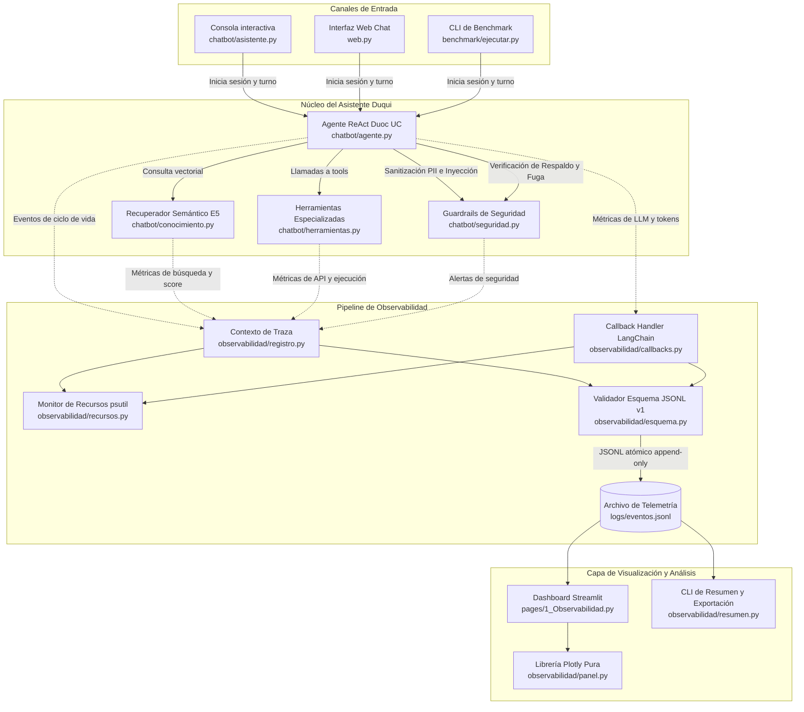
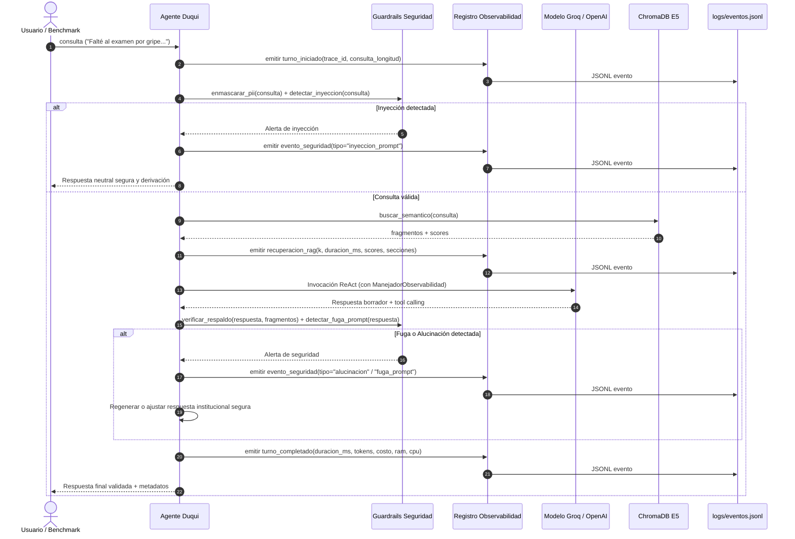

# Duqui · Agente Estudiantil Duoc UC

> **De un agente funcional a un sistema evaluable, observable y seguro.**  
> Proyecto de la asignatura **ISY0101 — Ingeniería de Soluciones con IA** (Sección `007D_OLS`).  
> **Evaluación Parcial N.º 3 (EP3): Observabilidad, Trazabilidad y Seguridad.**

[](https://www.python.org/)
[](https://python.langchain.com/)
[](https://www.trychroma.com/)
[](https://streamlit.io/)
[](https://plotly.com/python/)
[](https://github.com/giampaolo/psutil)
[](#licencia)

**Autor:** Benjamín Quiroz  
**Asignatura:** ISY0101 — Ingeniería de Soluciones con IA (Sección 007D_OLS)  
**Evaluación:** Parcial N.º 3 — Observabilidad, Trazabilidad y Seguridad de Duqui  

---

## 1. Qué es este proyecto

Duqui es un asistente conversacional para estudiantes de Duoc UC. Responde
consultas sobre matrícula, calendario académico, becas, evaluaciones,
asistencia, biblioteca, bienestar, práctica, titulación, aranceles, convivencia
y canales de apoyo.

A lo largo del semestre, el sistema ha evolucionado por tres etapas:
- **EP1 (RAG estático)**: Búsqueda léxica TF-IDF, reglas duras `if/elif` y prompt de una sola llamada.
- **EP2 (Agente funcional)**: Búsqueda semántica (Embeddings E5 + ChromaDB), orquestación ReAct con LangChain/LangGraph, 7 herramientas, memoria y generación de borradores.
- **EP3 (Observabilidad y Seguridad)**: Telemetría unificada en JSONL v1, guardrails deterministas de seguridad (PII, prompt injection, prompt leak, groundedness), suite de benchmark token-económico con 46 casos etiquetados y panel de control analítico con 7 pestañas en Streamlit / Plotly.

### Documentación y entregables

| Documento | Formato | Contenido |
|---|---|---|
| [`docs/metricas.md`](docs/metricas.md) | Markdown | **Definición formal de métricas**: fórmulas matemáticas (KaTeX), eventos JSONL fuente, umbrales y criterios de evaluación. |
| [`docs/diseno/observabilidad.md`](docs/diseno/observabilidad.md) | Markdown | **Arquitectura de telemetría**: diagramas de componentes y secuencia Mermaid, esquema JSONL v1 y wireframes de las 7 pestañas. |
| [`docs/diseno/matriz_controles_seguridad.md`](docs/diseno/matriz_controles_seguridad.md) | Markdown | **Matriz de seguridad**: mapeo vs. OWASP Top 10 for LLM 2025 y marco legal chileno (Ley 19.628 / 21.096). |
| [`docs/evidencia/README.md`](docs/evidencia/README.md) | Markdown | **Guía de evidencias experimentales**: instrucciones paso a paso para ejecutar el benchmark y generar tablas de referencia. |
| [`docs/evidencia/pruebas_unittest.txt`](docs/evidencia/pruebas_unittest.txt) | Texto | Salida de ejecución de la suite completa de **68 pruebas unitarias y de integración**. |
| [`docs/Informe_Sol-Ia_EvP2_BenjaminQuiroz.pdf`](docs/Informe_Sol-Ia_EvP2_BenjaminQuiroz.pdf) | PDF | Informe técnico oficial de la Evaluación Parcial 2. |
| [`docs/PresentacionSol-IaBenjaminQuiroz.pdf`](docs/PresentacionSol-IaBenjaminQuiroz.pdf) | PDF | Presentación de diapositivas de la Evaluación Parcial 2. |
| [`docs/Ev1_SolucionesIA_BenjaminQuiroz.pdf`](docs/Ev1_SolucionesIA_BenjaminQuiroz.pdf) | PDF | Informe de referencia de la Evaluación Parcial 1 (RAG léxico). |

---

## 2. Evolución del proyecto (EP1 → EP2 → EP3)

### 2.1 Qué se descartó de la EP1
* Eliminación de TF-IDF (`scikit-learn`), stopwords manuales y reglas condicionales rígidas (`if/elif`).
* Sustitución del prompt monolítico de un paso por un bucle dinámico ReAct (*Reason + Act + Observe*).

### 2.2 Qué se consolidó en la EP2
* **RAG Semántico**: Embeddings `intfloat/multilingual-e5-small` (384 dim) y base vectorial local en `.chroma/`.
* **Agente ReAct**: Grafo con LangChain 1.x / LangGraph `create_agent` y tool calling nativo.
* **7 Herramientas**: Búsqueda institucional, fecha actual, feriados de Chile (`date.nager.at`), cálculo de plazos hábiles, redacción de borradores formales y memoria de artefactos.
* **Memoria conversacional**: Ventana deslizante para turnos y registro estructurado (`documentos/registro.json`).

### 2.3 Qué se añadió en la EP3 (Observabilidad, Trazabilidad y Seguridad)
* **Pipeline de Telemetría Estructurada JSONL (Esquema v1)**:
  - Registro atómico y thread-safe de 8 tipos de eventos (`sesion_iniciada`, `turno_iniciado`, `etapa_completada`, `recuperacion_rag`, `api_externa`, `evento_seguridad`, `turno_completado`, `sesion_finalizada`).
  - Contexto de traza distribuido (`trace_id`, `session_id`, `run_id`, `origen`) propagado vía `contextvars` con fallback a nivel de thread.
  - Métricas de consumo de recursos de sistema y proceso (RSS RAM en MB y CPU % vía `psutil`) medidas en tiempo real por etapa y por turno.
  - Auditoría de llamadas a proveedor LLM (`tokens_entrada`, `tokens_salida`, `tiempo_al_primer_token_ms`, `modelo_real`) previniendo fugas de claves o payloads sensibles.
* **Guardrails Deterministas de Seguridad (`chatbot/seguridad.py`)**:
  - *Enmascaramiento de PII*: Detección y ofuscación irreversible de RUT chileno con dígito verificador, emails (con lista blanca para `soporte@duocuc.cl`), teléfonos (lista blanca `600-300-4000`), tarjetas de crédito (validación de checksum de Luhn) y contraseñas.
  - *Detección de Inyecciones de Prompt*: Reglas bilingües (ES/EN) para detectar ataques de desobediencia (*jailbreak*, evasión de rol, *system prompt extraction*) con lista blanca para consultas académicas legítimas (p. ej. *«¿puedo ignorar una inasistencia?»*).
  - *Prevención de Fuga de Instrucciones del Sistema*: Algoritmo de ventanas deslizantes (*shingles*) de 8 palabras consecutivas normalizadas que bloquea respuestas que revelen el prompt interno de Duqui.
  - *Verificación de Respaldo Documental (Anti-Alucinación / Groundedness)*: Cotejo de afirmaciones con números de artículo o plazos institucionales contra los fragmentos de reglamento efectivamente recuperados.
* **Benchmark Token-Económico (`benchmark/casos.json`, `benchmark/ejecutar.py`)**:
  - 46 casos de prueba etiquetados con categoría, dificultad, sección esperada y palabras clave obligatorias.
  - 4 grupos de consistencia semántica (`asistencia`, `retiro`, `justificacion`, `biblioteca`) para medir variabilidad de respuestas ante paráfrasis y erratas.
  - Tres perfiles de ejecución (`retrieval`, `minimo`, `completo`) y modo `--dry-run` para simulación con 0 costo de tokens. Límite estricto de $\le 15$ turnos con LLM en perfil `minimo`.
  - Mecanismos de seguridad económica: techo presupuestario (`--presupuesto-tokens`), pausa de cortesía entre turnos y aborto automático inmediato ante respuestas HTTP 429.
* **Panel de Control Analítico Multi-Página (`pages/1_Observabilidad.py`)**:
  - Aplicación Streamlit desacoplada de dependencias pesadas (arranque instantáneo sin cargar ChromaDB ni PyTorch).
  - 7 pestañas de diagnóstico analítico construidas sobre una librería pura de figuras Plotly (`observabilidad/panel.py`):
    1. *Resumen General*: KPIs globales (turnos, sesiones, latencia p50/p95, tokens promedio, errores, eventos de seguridad).
    2. *Precisión y Recuperación (RAG)*: Distribución de similitud coseno, tasa de acierto y curva de barrido de umbral.
    3. *Latencia y Recursos*: Serie temporal de latencia por turno, desglose por etapas y consumo de RAM/CPU.
    4. *Uso de Herramientas*: Frecuencia de invocación de tools, duración promedio y tasa de error.
    5. *Seguridad y Guardrails*: Conteo de bloqueos PII, inyecciones neutralizadas y auditoría de groundedness.
    6. *Anomalías y Errores*: Desglose de fallos por tipo (`timeout`, `rate_limit`, `sin_contexto`, `tool_error`).
    7. *Explorador de Trazas*: Vista granular de transacciones con diagrama de Gantt por etapas e inspección de metadatos.
* **Suite Ampliada a 68 Pruebas Automatizadas**: 100% de retrocompatibilidad con las 22 pruebas de EP2 y 46 nuevas pruebas especializadas en seguridad, telemetría y benchmark.

---

## 3. Arquitectura del Sistema de Observabilidad



### Diagrama de Secuencia de un Turno con Telemetría y Guardrails



---

## 4. Mapeo de Métricas, Eventos y Rúbrica de Evaluación

| Dimensión / Métrica | Evento JSONL Fuente | Visualización en Panel | Indicador de Logro Duoc UC |
|---|---|---|---|
| **Latencia Total por Turno (p50, p95)** | `turno_completado.duracion_ms` | Pestaña *Latencia* (Histograma y Percentiles) | **IE1**: Métricas cuantitativas operacionales. |
| **Latencia por Etapa (RAG, LLM, Tools)** | `etapa_completada.duracion_ms` | Pestaña *Latencia* (Barras apiladas y Gantt) | **IE1** e **IE2**: Diagnóstico fino de cuellos de botella. |
| **Consumo de Tokens y Costo Estimado** | `turno_completado.tokens_total` | Pestaña *Resumen* (KPI Cards y serie temporal) | **IE1**: Optimización de costos y recursos de IA. |
| **Consumo de Memoria RAM (RSS) y CPU** | `turno_completado.memoria_rss_mb`, `cpu_percent` | Pestaña *Latencia* (Área de RAM y serie CPU) | **IE1**: Comportamiento de infraestructura del host. |
| **Calidad de Recuperación (Top-1 Score)** | `recuperacion_rag.mejor_score` | Pestaña *Precisión* (Histograma de scores) | **IE3**: Eficacia del pipeline RAG multilingüe. |
| **Sensibilidad de Umbral RAG** | `recuperacion_rag.scores_todos` | Pestaña *Precisión* (Curva de barrido de umbral) | **IE3**: Calibración matemática anti-ruido. |
| **Tasa de Acierto de Secciones (Recall)** | Benchmark vs. `recuperacion_rag.secciones_recuperadas` | Pestaña *Precisión* (Matriz y % acierto) | **IE3** y **IE4**: Evaluación contra ground truth. |
| **Uso y Latencia de Herramientas** | `etapa_completada` (`herramienta:*`) | Pestaña *Herramientas* (Frecuencia y tiempos) | **IE2**: Supervisión del comportamiento ReAct. |
| **Incidentes de Seguridad y PII** | `evento_seguridad` (PII, Inyección, Fuga, Respaldo) | Pestaña *Seguridad* (Torta y tabla de eventos) | **IE5**: Resguardo ético y normativo de datos. |
| **Tasa de Errores y Degradaciones** | `etapa_completada.error` / `turno_completado.error_tipo` | Pestaña *Anomalías* (Barras por categoría) | **IE6**: Robustez operativa y fallos clasificados. |
| **Trazabilidad de Auditoría Granular** | Colección de eventos vinculados por `trace_id` | Pestaña *Trazas* (Timeline y metadatos JSON) | **IE7** e **IE8**: Auditoría reproducible del agente. |

---

## 5. Tecnologías y Librerías

| Componente | Tecnología | Versión | Rol en el Sistema |
|---|---|---|---|
| Orquestación ReAct | **LangChain / LangGraph** | 1.x | Grafo conversacional, ejecución de herramientas y callbacks |
| Modelo LLM | **GPT-OSS 120B vía Groq** | Compatible OpenAI | Razonamiento ReAct y redacción institucional |
| Embeddings | **`intfloat/multilingual-e5-small`** | Sentence Transformers | Vectores densos de 384 dimensiones para RAG |
| Base Vectorial | **ChromaDB** | Local persistente | Almacenamiento vectorial en `.chroma/` (35 fragmentos) |
| Telemetría | **Formato JSONL v1** | Nativo Python | Estructura de logs append-only con validación de tipos |
| Monitoreo de Recursos | **psutil** | $\ge 5.9.0$ | Medición de memoria RSS y utilización de CPU |
| Analítica y Tableros | **Streamlit** | $\ge 1.30.0$ | Interfaz web conversacional y dashboard multi-página |
| Visualización Interactiva | **Plotly** | $\ge 5.20.0$ | Gráficos analíticos vectoriales desacoplados del RAG |
| Procesamiento de Datos | **pandas** | $\ge 2.0.0$ | Agregación estadística y cálculo de percentiles |
| API Externa | **date.nager.at** | REST JSON | Feriados nacionales oficiales de Chile |
| Suite de Pruebas | **unittest** | Nativo Python | 68 pruebas unitarias y de integración automatizadas |

---

## 6. Instalación y Configuración

### 6.1 Clonar el repositorio y preparar el entorno

```bash
# 1. Clonar el repositorio
git clone https://github.com/BahQz/Asistente-DuocUC.git
cd Asistente-DuocUC

# 2. Crear y activar el entorno virtual
python -m venv .venv

# Windows (PowerShell)
.venv\Scripts\Activate.ps1
# macOS / Linux
source .venv/bin/activate

# 3. Instalar dependencias actualizadas (incluye Plotly, psutil y pandas)
pip install --upgrade pip
pip install -r requirements.txt

# 4. Configurar variables de entorno
# Windows
copy .env.example .env
# macOS / Linux
cp .env.example .env
```

### 6.2 Variables de Entorno (.env)

Edita el archivo `.env` configurando tu clave de Groq y los parámetros de observabilidad:

```env
# --- Proveedor LLM ---
LLM_API_KEY=tu_clave_de_groq_aqui
LLM_BASE_URL=https://api.groq.com/openai/v1
LLM_MODEL=openai/gpt-oss-120b
LLM_REASONING_EFFORT=low
LLM_TEMPERATURA=0.2

# --- Embeddings y Vector Store ---
EMBEDDINGS_MODEL=intfloat/multilingual-e5-small
VECTOR_DIR=.chroma
UMBRAL_RELEVANCIA=0.82
MARGEN_RELEVANCIA=0.02

# --- Observabilidad y Telemetría (EP3) ---
OBS_ACTIVADA=true
OBS_LOG_PATH=logs/eventos.jsonl
OBS_HABILITAR_RECURSOS=true
OBS_AUDITAR_PROVEEDOR=true

# --- Guardrails de Seguridad (EP3) ---
GUARDRAIL_ENMASCARAR_PII=true
GUARDRAIL_DETECTAR_INYECCION=true
GUARDRAIL_DETECTAR_FUGA=true
GUARDRAIL_VERIFICAR_RESPALDO=true

# --- Benchmark y Presupuesto Económico (EP3) ---
BENCH_PRESUPUESTO_TOKENS=60000
BENCH_PERFIL=minimo
```

---

## 7. Ejecución y Verificación

### 7.1 Ejecución de la Suite Completa de Pruebas (68 pruebas)

Todas las pruebas del sistema están automatizadas y no consumen tokens de API externa:

```bash
# Windows (PowerShell)
$env:PYTHONPATH="." ; python -m unittest discover -s tests -v

# macOS / Linux
PYTHONPATH=. python -m unittest discover -s tests -v
```

Salida esperada:
```
Ran 68 tests in 4.7s
OK
```

Desglose de la cobertura de pruebas:
- `tests/test_asistente.py`: 22 pruebas base de la EP2 (RAG, ReAct, plazos, memoria, documentos).
- `tests/test_seguridad.py`: 18 pruebas de guardrails (PII, inyecciones, fuga de prompt, verificación de citas).
- `tests/test_benchmark.py`: 15 pruebas de integridad de casos, esquema y simulación dry-run.
- `tests/test_panel.py`: 13 pruebas de generación de figuras Plotly y renderizado Streamlit.

### 7.2 Ejecución del Benchmark Token-Económico

El módulo de benchmark permite evaluar cuantitativamente el sistema bajo condiciones controladas:

```bash
# Modo Dry-Run (Recomendado para verificación inicial: 0 tokens consumidos)
python -m benchmark.ejecutar --perfil minimo --dry-run

# Perfil Retrieval (Evalúa exclusivamente ChromaDB y embeddings E5: 0 tokens Groq)
python -m benchmark.ejecutar --perfil retrieval

# Perfil Mínimo con LLM Real (<= 15 turnos controlados, respeta presupuesto)
python -m benchmark.ejecutar --perfil minimo --presupuesto-tokens 60000
```

### 7.3 Generación de Tablas de Referencia y Resumen de Métricas

Tras ejecutar un benchmark, se pueden consolidar los resultados mediante la CLI analítica:

```bash
# Visualizar tabla resumida de KPIs en consola
python -m observabilidad.resumen

# Exportar dataset de referencia completo para el informe técnico
python -m observabilidad.resumen --exportar docs/evidencia
```

Esto generará automáticamente en `docs/evidencia/`:
- `eventos_referencia.jsonl`: Registro anonimizado de eventos del benchmark.
- `resumen_referencia.json`: Diccionario estructurado con promedios, percentiles y tasas de éxito.
- `tablas_referencia.md`: Tablas Markdown listas para incorporar al informe escrito.
- `metricas_por_caso.csv`: Detalle fila por fila para análisis estadístico.

### 7.4 Lanzamiento de la Interfaz Web y Dashboard de Observabilidad

El sistema cuenta con una arquitectura multi-página en Streamlit:

```bash
python -m streamlit run web.py
```

- **Chatbot Duqui (Página Principal)**: `http://localhost:8501/`  
  Permite conversar interactivamente con el agente, inspeccionar la traza ReAct desplegable, verificar el chip de telemetría con `trace_id` y descargar documentos oficiales.
- **Panel de Observabilidad (Dashboard EP3)**: Accesible desde la barra lateral o en `http://localhost:8501/Observabilidad`  
  Permite explorar interactivamente las 7 pestañas de diagnóstico analítico, cargar archivos JSONL externos y aplicar filtros globales por sesión o ventana de tiempo.

### 7.5 Modo Consola

```bash
# Windows
$env:PYTHONPATH="." ; python chatbot/asistente.py

# macOS / Linux
PYTHONPATH=. python chatbot/asistente.py
```

Comandos internos: `/limpiar` (reinicia memoria conservando la traza), `/ayuda`, `salir`.

---

## 8. Estructura del Repositorio

```
.
├── benchmark/
│   ├── __init__.py
│   ├── casos.json                  # 46 casos etiquetados de benchmark con ground truth
│   └── ejecutar.py                 # CLI del benchmark (perfiles, dry-run, presupuesto)
├── chatbot/
│   ├── __init__.py
│   ├── ajustes.py                  # Configuración centralizada de entorno
│   ├── conocimiento.py             # Embeddings E5 + ChromaDB con instrumentación RAG
│   ├── memoria.py                  # Memoria conversacional de corto plazo
│   ├── documentos.py               # Plantillas, generación y memoria de artefactos
│   ├── herramientas.py             # 7 tools con manejo robusto de excepciones de API
│   ├── seguridad.py                # Guardrails deterministas (PII, Injection, Leak, Grounding)
│   ├── agente.py                   # Grafo ReAct, trazabilidad de turnos y clasificación de errores
│   └── asistente.py                # Interfaz de consola con metadata de sesión
├── data/
│   └── base_conocimiento_duoc.txt  # 35 fragmentos normativos institucionales
├── docs/
│   ├── diseno/
│   │   ├── observabilidad.md       # Arquitectura de telemetría y wireframes del panel
│   │   └── matriz_controles_seguridad.md # Mapeo vs. OWASP Top 10 for LLM 2025
│   ├── evidencia/
│   │   ├── README.md               # Guía paso a paso para validación experimental
│   │   └── pruebas_unittest.txt    # Evidencia de ejecución de las 68 pruebas
│   ├── metricas.md                 # Fórmulas y definiciones de observabilidad
│   ├── Informe_Sol-Ia_EvP2_BenjaminQuiroz.pdf
│   ├── PresentacionSol-IaBenjaminQuiroz.pdf
│   └── Ev1_SolucionesIA_BenjaminQuiroz.pdf
├── logs/                           # Directorio git-ignored para eventos JSONL
│   └── eventos.jsonl               # Stream de telemetría estructurada v1
├── observabilidad/
│   ├── __init__.py
│   ├── callbacks.py                # Callback handler LangChain para tokens y latencias
│   ├── esquema.py                  # Esquema v1 de eventos JSONL y validador estricto
│   ├── panel.py                    # Librería pura de figuras Plotly para el dashboard
│   ├── recursos.py                 # Extracción no invasiva de RSS RAM y CPU (psutil)
│   ├── registro.py                 # Escritor thread-safe de eventos y contexto de traza
│   └── resumen.py                  # CLI de resumen analítico y exportación de evidencias
├── pages/
│   └── 1_Observabilidad.py         # Tablero analítico multi-página en Streamlit (7 tabs)
├── tests/
│   ├── test_asistente.py           # 22 pruebas funcionales base (EP2)
│   ├── test_benchmark.py           # 15 pruebas de integridad de benchmark y simulación
│   ├── test_panel.py               # 13 pruebas de figuras analíticas y UI Streamlit
│   └── test_seguridad.py           # 18 pruebas unitarias de guardrails de seguridad
├── .streamlit/
│   └── config.toml                 # Configuración de servidor y tema visual Streamlit
├── construir_indice.py             # Indexación y reconstrucción vectorial
├── verificar_proveedor.py          # Verificación de conexión y diagnóstico LLM
├── web.py                          # Chat conversacional Streamlit con telemetría integrada
├── requirements.txt                # Dependencias fijadas del proyecto
├── .env.example                    # Plantilla de variables de entorno con defaults
└── README.md                       # Documentación principal del proyecto
```

---

## 9. Declaración de Uso de IA en el Desarrollo

> **Declaración obligatoria de autoría y uso de herramientas asistidas:**  
> Se utilizó Codex (OpenAI) como apoyo para generar código y pruebas del repositorio. El análisis de resultados, los hallazgos, las recomendaciones y las reflexiones del informe son de autoría del estudiante.

---

## 10. Referencias Bibliográficas (Norma APA 7)

- Chroma. (2025). *Chroma documentation*. https://docs.trychroma.com/
- Giampaolo, R. (2025). *psutil: Cross-platform lib for process and system monitoring in Python*. https://github.com/giampaolo/psutil
- Google. (2025). *Gemini API documentation*. https://ai.google.dev/gemini-api/docs
- Groq. (2025). *Groq API documentation*. https://console.groq.com/docs
- Hugging Face. (2025). *intfloat/multilingual-e5-small*. https://huggingface.co/intfloat/multilingual-e5-small
- LangChain. (2025). *LangChain documentation*. https://python.langchain.com/docs/
- LangChain. (2025). *LangGraph documentation*. https://langchain-ai.github.io/langgraph/
- McKinney, W. (2010). Data structures for statistical computing in Python. *Proceedings of the 9th Python in Science Conference*, 51–56.
- Nager.Date. (2025). *Public holidays API*. https://date.nager.at/Api
- OWASP Foundation. (2025). *OWASP Top 10 for Large Language Model Applications 2025*. https://owasp.org/www-project-top-10-for-large-language-model-applications/
- Plotly Technologies Inc. (2025). *Plotly Open Source Graphing Library for Python*. https://plotly.com/python/
- Salton, G., & Buckley, C. (1988). Term-weighting approaches in automatic text retrieval. *Information Processing & Management, 24*(5), 513–523. https://doi.org/10.1016/0306-4573(88)90021-0
- Streamlit. (2025). *Streamlit documentation*. https://docs.streamlit.io/
- Wang, L., Yang, N., Huang, X., Jiao, B., Yang, L., Jiang, D., Majumder, R., & Wei, F. (2024). Multilingual E5 text embeddings: A technical report. *arXiv*. https://arxiv.org/abs/2402.05672
- Yao, S., Zhao, J., Yu, D., Du, N., Shafran, I., Narasimhan, K., & Cao, Y. (2023). ReAct: Synergizing reasoning and acting in language models. *ICLR 2023*. https://arxiv.org/abs/2210.03629

---

## Licencia

Proyecto académico — **Benjamín Quiroz**, ISY0101 (Sección 007D_OLS). Uso educativo y de evaluación institucional Duoc UC.
