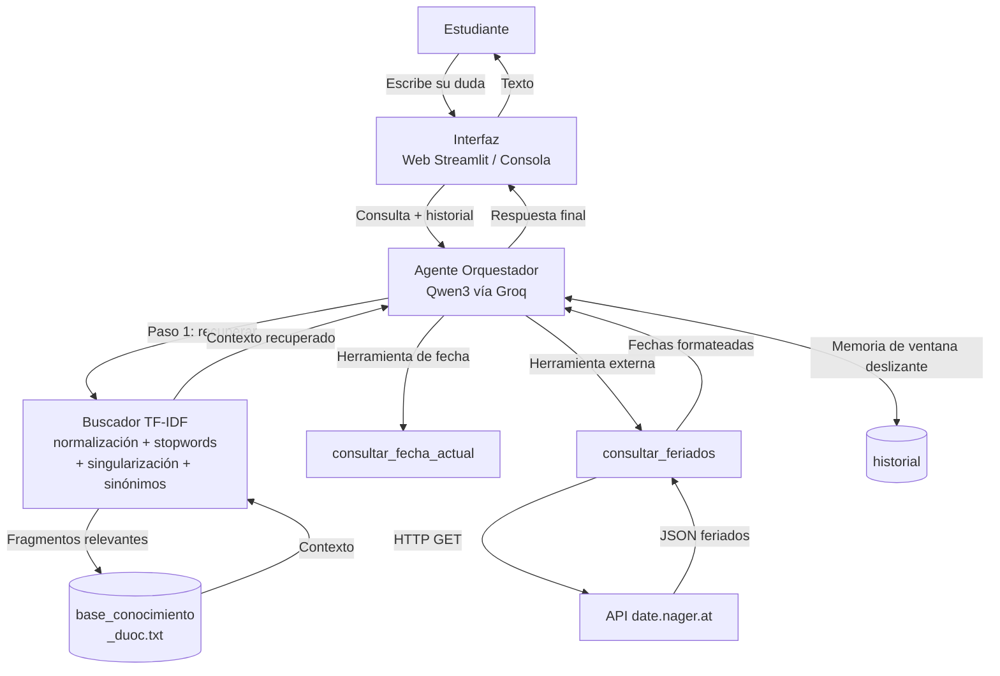

# Arquitectura del Asistente Estudiantil Duoc UC

**Autor:** Benjamín Quiroz

## Diagrama de Arquitectura

## Componentes

| Componente | Descripción |
|---|---|
| **Interfaz (Web / Consola)** | La web (`web.py`, Streamlit) y la consola (`chatbot/asistente.py`) comparten el mismo pipeline. La web muestra burbujas de chat, sugerencias y el panel **Fuentes consultadas**; la memoria vive en `st.session_state`. |
| **Agente Orquestador** | Modelo Qwen3 servido por Groq (API compatible con OpenAI), temperatura 0.1 y `reasoning_effort="none"`. |
| **Buscador TF-IDF** | Carga la base de conocimiento, la divide por secciones (`## `) y las puntúa con frecuencia de término (TF) por frecuencia inversa (IDF), normalización de acentos, stopwords, singularización y sinónimos. |
| **Base de conocimiento** | `data/base_conocimiento_duoc.txt` con 11 secciones (matrícula, calendario, becas, evaluaciones, biblioteca, bienestar, práctica, pagos, contacto, convivencia y ayuda). |
| **consultar_fecha_actual** | Entrega la fecha de hoy en español para calcular plazos. |
| **consultar_feriados** | Consulta la API pública `date.nager.at` para obtener los feriados de Chile de un año. Incluye User-Agent, timeout y reintentos. |
| **Memoria conversacional** | Ventana deslizante (`MemoriaVentanaDeslizante`) sobre `collections.deque`: conserva `MEMORIA_MAX_TURNOS` turnos y descarta los más antiguos. Se persiste en `.historial/sesion.json`. |

## Tipo de memoria: ventana deslizante

La memoria de `chatbot/memoria.py` es de **ventana deslizante**. Se eligió
porque:

- **Acota el contexto**: mantiene solo los últimos `N` intercambios, evitando
  que el prompt crezca sin límite.
- **Conversación multi-turno**: permite resolver referencias como *"¿y eso
  aplica para todas las carreras?"*, que dependen del turno anterior.
- **Persistencia opcional**: guarda la sesión en disco, de modo que el hilo se
  recupera al reiniciar.

## Recuperación (RAG léxico con TF-IDF)

`chatbot/conocimiento.py` implementa un índice invertido sin dependencias
externas:

1. **Normalización**: minúsculas y eliminación de acentos (`unicodedata`).
2. **Stopwords**: se descartan palabras vacías que antes dominaban el puntaje.
3. **Singularización**: se quita la `-s`/`-es` final (`becas` → `beca`).
4. **Sinónimos**: mapa de términos del dominio (`plata → arancel`,
   `nota → calificación`, `beca → beneficio`…).
5. **Ponderación**: cada coincidencia pesa `tf × idf`, y una coincidencia en el
   título de la sección suma puntaje extra.

Si ninguna palabra de contenido coincide, se devuelve una lista vacía y el
agente responde que no cuenta con la información (anti-alucinación).

## Flujo de Ejecución

1. El estudiante escribe una pregunta en la web o la consola.
2. El sistema recupera los fragmentos más relevantes de la base de conocimiento.
3. Si la consulta pide la fecha o los feriados, se invocan las herramientas y
   el resultado se añade al contexto.
4. El modelo recibe prompt de sistema + historial + contexto + pregunta.
5. El agente genera una respuesta fundamentada y guarda el turno en memoria.
6. Si la información no está en las fuentes, el agente lo declara y deriva a la
   mesa de ayuda.
