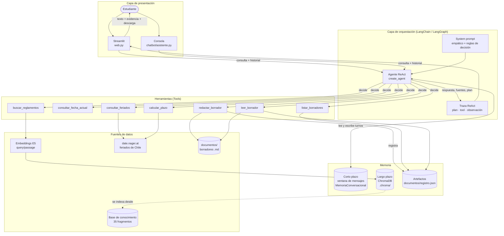
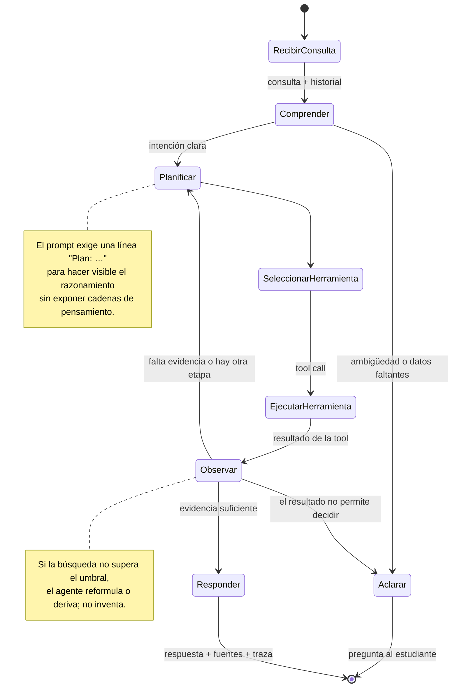
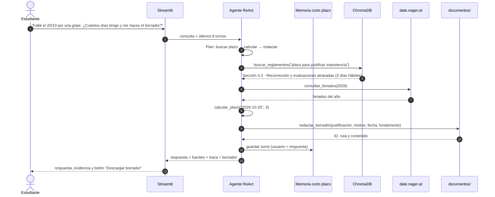
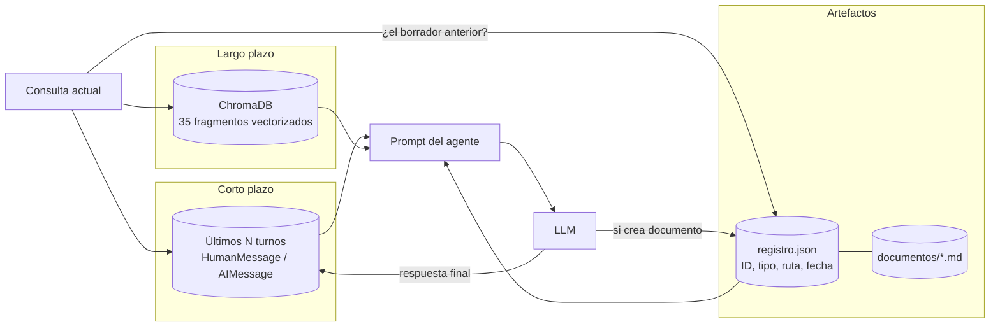
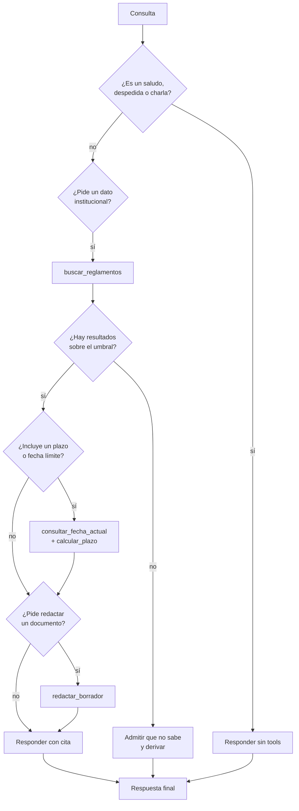

# Arquitectura del agente — Duqui (EP2)

**Autor:** Benjamín Quiroz
**Asignatura:** ISY0101 — Ingeniería de Soluciones con IA
**Versión:** 2.0 (Evaluación Parcial 2)

Este documento describe la orquestación del agente, las decisiones de diseño y
los flujos de trabajo. Los diagramas están en **Mermaid** y se renderizan en
GitHub, GitLab y cualquier visor compatible.

---

## 1. Vista general

### Lectura del diagrama

1. El estudiante interactúa con Streamlit o con la consola.
2. La consulta viaja al agente junto con la ventana de mensajes reciente.
3. El agente razona y emite **tool calls**. LangGraph ejecuta la herramienta,
   devuelve la observación y vuelve al modelo hasta que haya una respuesta final.
4. Las herramientas de consulta usan ChromaDB y la API de feriados; la de
   escritura persiste documentos y los registra.
5. La interfaz muestra la respuesta, las fuentes, la traza y los archivos.

---

## 2. Bucle ReAct

**Condición de término:** el modelo emite un `AIMessage` sin `tool_calls`, o se
alcanza `AGENTE_MAX_ITERACIONES` (18), lo que protege contra bucles.

---

## 3. Secuencia de una tarea multi-etapa

Caso: justificar una inasistencia y generar el documento.

---

## 4. Memoria y recuperación de contexto

### 4.1 Corto plazo

- Implementación: `chatbot/memoria.py` → `MemoriaConversacional`.
- Estructura: `deque(maxlen=max_turnos * 2)` de mensajes LangChain.
- Persistencia: `MEMORIA_RUTA` (consola) o `st.session_state` (web).
- Recorte: descarta los turnos más antiguos; evita crecimiento ilimitado del
  prompt.
- Limpieza: botón “Limpiar conversación” o comando `/limpiar`.

### 4.2 Largo plazo

- Implementación: `chatbot/conocimiento.py`.
- Almacén: ChromaDB persistente en `.chroma/`.
- Modelo: `intfloat/multilingual-e5-small` (384 dimensiones, normalizado).
- Metadatos por fragmento: `id`, `seccion`, `titulo`, `numero`, `fuente`,
  `orden`.
- Reconstrucción automática si cambia el hash del reglamento, el modelo o
  `VERSION_INDICE`.

### 4.3 Artefactos

- Implementación: `chatbot/documentos.py`.
- Registro: `documentos/registro.json` (máximo 100 entradas).
- Herramientas: `listar_borradores`, `leer_borrador`.
- Propósito: continuidad de tareas más allá de la ventana conversacional.

---

## 5. Enrutamiento a herramientas

> El diagrama es **conceptual**: el agente no ejecuta este árbol como código
> rígido. El LLM recibe las descripciones de las herramientas y decide; el
> diagrama resume el comportamiento esperado y las reglas del prompt.

### Contratos de las herramientas

| Herramienta | Entrada | Salida | Efecto |
|---|---|---|---|
| `buscar_reglamentos` | `consulta: str`, `top_k: int = 3` | Fragmentos con sección, título y relevancia | Consulta de solo lectura |
| `consultar_fecha_actual` | — | Fecha en español | Sin efecto |
| `consultar_feriados` | `anio: int = 0`, `solo_proximos: bool = False` | Lista de feriados | Llamada HTTP con caché |
| `calcular_plazo` | `fecha_inicio: str`, `dias_habiles: int`, `proposito: str` | Fecha de vencimiento y feriados excluidos | Sin efecto |
| `redactar_borrador` | `tipo`, `motivo`, `nombre_estudiante`, `asignatura`, `fecha_referencia`, `detalles`, `fundamento` | ID, ruta y contenido | **Escribe archivo y registro** |
| `listar_borradores` | `limite: int = 5` | Lista de metadatos | Solo lectura |
| `leer_borrador` | `identificador: str` | Contenido completo | Solo lectura |

---

## 6. Flujo de una consulta (request lifecycle)

1. **Entrada.** Streamlit recibe el texto y recupera la memoria de la sesión.
2. **Composición.** Se construye `historial + HumanMessage(consulta)`.
3. **Inferencia.** `create_agent` envía el prompt del sistema, el historial y
   las definiciones de tools al modelo.
4. **Decisión.** El modelo puede:
   - responder directamente (charla);
   - emitir uno o más `tool_calls`.
5. **Ejecución.** LangGraph ejecuta la herramienta y agrega un `ToolMessage`
   con la observación.
6. **Iteración.** El modelo recibe la observación y decide si necesita otra
   herramienta o si ya puede responder.
7. **Extracción.** `chatbot/agente.py` separa:
   - respuesta final (`AIMessage` sin tool calls);
   - eventos (plan, herramienta, argumentos, resultado);
   - fuentes (regex sobre la salida de `buscar_reglamentos`);
   - borradores (ID + lectura del registro).
8. **Persistencia.** Se guardan usuario y respuesta en la memoria; si hay
   borrador, ya quedó en disco y en el registro.
9. **Render.** La UI muestra respuesta, fuentes, traza y descarga.

---

## 7. Decisiones de diseño y alternativas

### 7.1 ¿Por qué LangChain/LangGraph y no un bucle propio?

| Criterio | Implementación propia | LangChain + LangGraph |
|---|---|---|
| Tool calling | Parseo manual de JSON y estados | `@tool` + esquema automático |
| Ciclo ReAct | While + manejo de errores | Grafo con estado y límite de recursión |
| Trazabilidad | Logs propios | Mensajes `AIMessage`/`ToolMessage` inspeccionables |
| Escalabilidad | Cada función nueva exige integración manual | Agregar un `@tool` y reiniciar |
| Compatibilidad | Depende del proveedor | Gemini nativo y modelos compatibles con OpenAI |

Se eligió LangChain por su integración nativa con Gemini y con endpoints
compatibles con OpenAI (Groq u OpenRouter), su sistema de tools y su ecosistema
de memoria y vectores. LangGraph aporta el control del ciclo y el límite de
iteraciones.

### 7.2 ¿Por qué ChromaDB y no FAISS?

- Chroma persiste metadatos y documentos, no solo vectores.
- Permite filtrar por metadatos a futuro (sección, vigencia, carrera).
- Su API se integra con LangChain (`langchain-chroma`).
- FAISS es más rápido a gran escala, pero este corpus es pequeño (35 fragmentos)
  y la prioridad es la persistencia y la trazabilidad.

### 7.3 ¿Por qué E5 small?

- Multilingüe y entrenado para español.
- 384 dimensiones: rápido en CPU y suficiente para 35 fragmentos.
- Requiere prefijos `query:` / `passage:`; el adaptador los aplica.
- Alternativas: `paraphrase-multilingual-MiniLM` (peor en erratas),
  `multilingual-e5-base` (más precisión, más costo), `bge-m3` (muy pesado para
  un notebook).

### 7.4 ¿Por qué ventana de mensajes y no `ConversationBufferMemory`?

`ConversationBufferMemory` es una API legada en LangChain 1.x. La ventana de
mensajes es el reemplazo recomendado, equivalente a
`ConversationBufferWindowMemory`, y permite:

- controlar tokens;
- persistir/limpiar por sesión;
- inyectar el historial en el grafo sin estado global;
- separar memoria conversacional de memoria de artefactos.

### 7.5 ¿Por qué umbral + margen?

Un umbral absoluto solo no basta: E5 comprime los puntajes. El margen relativo
evita que el agente reciba secciones apenas relacionadas cuando el mejor
resultado es claramente superior. Si el agente necesita más contexto, puede
volver a buscar con otra formulación (comportamiento ReAct).

### 7.6 ¿Por qué plantillas para los borradores?

- Garantizan estructura formal y referencias correctas.
- Evitan que el modelo invente datos personales o normativos.
- Son testeables y deterministas.
- El agente aporta el contexto (motivo, fechas, fundamento) y decide cuándo
  generar el documento.

---

## 8. Manejo de errores y límites

| Situación | Comportamiento |
|---|---|
| Falta `LLM_API_KEY` | `ErrorConfiguracion` con instrucciones; la UI muestra un aviso |
| 401 / clave inválida | Mensaje claro; no se reintenta |
| 429 / rate limit | Reintento con espera (3 s, 6 s) |
| Timeout del modelo | Reintento; luego `ErrorAgente` |
| API de feriados caída | `calcular_plazo` avisa y excluye solo fines de semana |
| Sin resultados semánticos | La tool devuelve “sin resultados”; el agente no inventa |
| Bucle de tools | Límite de 18 pasos |
| Borrador no encontrado | `leer_borrador` sugiere `listar_borradores` |
| Consulta vacía | Respuesta amable sin llamar al modelo |

---

## 9. Escalabilidad

- **Más documentos:** agregar secciones a `data/base_conocimiento_duoc.txt` y
  ejecutar `python construir_indice.py --reindexar`.
- **Más herramientas:** crear una función con `@tool` en
  `chatbot/herramientas.py`, agregarla a `HERRAMIENTAS`; el prompt la descubre
  por su docstring.
- **Más sedes/carreras:** agregar metadatos y filtros en `buscar_semantico`.
- **Multiusuario:** reemplazar `MemoriaConversacional` por un checkpointer de
  LangGraph (`MemorySaver`/`SqliteSaver`) con `thread_id` por sesión.
- **Producción:** mover borradores a object storage, agregar autenticación y
  trazas con LangSmith.

---

## 10. Referencias

- LangChain. (2025). *Agents*. https://python.langchain.com/docs/concepts/agents/
- LangGraph. (2025). *Agentic workflows*.
  https://langchain-ai.github.io/langgraph/
- Chroma. (2025). *Collection and metadata filtering*.
  https://docs.trychroma.com/
- Wang, L. et al. (2024). *Multilingual E5 text embeddings*.
  https://arxiv.org/abs/2402.05672
- Yao, S. et al. (2023). *ReAct: Synergizing reasoning and acting in language
  models*. https://arxiv.org/abs/2210.03629
- Nager.Date. (2025). *Public holidays API*. https://date.nager.at/Api
