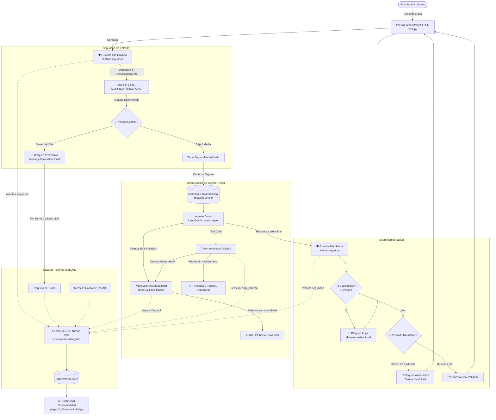
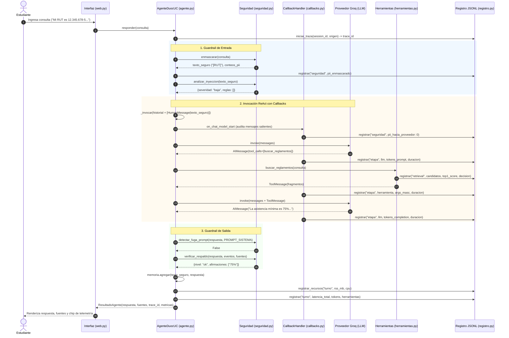
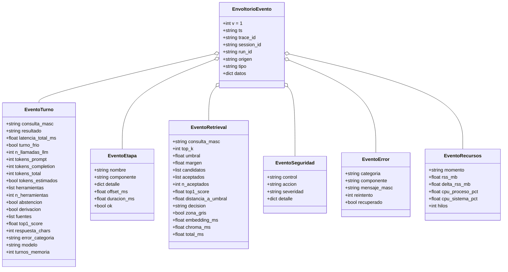

# Bocetos de Diseño y Arquitectura de Observabilidad (EP3)

Este documento contiene los diagramas técnicos de diseño de arquitectura, secuencia de ejecución, modelo de datos y wireframes del dashboard de observabilidad para el agente Duqui.

---

## 1. Arquitectura General del Sistema de Observabilidad

El sistema incorpora tres capas concéntricas: **Guardrails deterministas** (entrada y salida), **Instrumentación de callbacks** en el ciclo ReAct, y **Persistencia estructurada thread-safe en JSONL**, desacoplada de la interfaz de usuario.



---

## 2. Diagrama de Secuencia de un Turno

Muestra el flujo sincrónico desde que ingresa la consulta hasta la persistencia y respuesta:



---

## 3. Modelo de Datos de Eventos (JSONL)

El contrato del registro se basa en un envoltorio común con 8 subtipos de eventos validados estrictamente por `observabilidad/esquema.py`:



---

## 4. Wireframes Textuales del Dashboard (`pages/1_Observabilidad.py`)

A continuación se presentan los esquemas visuales en texto de las 7 pestañas del dashboard interactivo:

### Tab 1: Resumen de Rendimiento
```
+---------------------------------------------------------------------------------------------------+
| [📊 Turnos: 45]  [✅ Éxito: 97.8%]  [⚡ P50: 1.2s]  [⚡ P95: 3.4s]  [🪙 Tokens: 54,200]             |
| [🪙 Media: 1,204] [🛑 Bloqueo: 4.4%] [📚 Abstención: 8] [📞 Derivación: 5] [⚠️ Zona Gris: 2]     |
+---------------------------------------------------------------------------------------------------+
| [GRÁFICO PLOTLY: Latencia Total por Turno (ms) con líneas P50 y P95]                              |
|   ms                                                                                              |
| 3500|                  *                                      * (P95: 3400 ms)                    |
| 1200|  *   *   *   *       *   *   *   *   *   *   *   *  -- (P50: 1200 ms)                    |
|  200|_______________________________________________________                                      |
|      #1  #5  #10  #15  #20  #25  #30  #35  #40  #45 (Turnos)                                      |
+---------------------------------------------------------------------------------------------------+
```

### Tab 2: Precisión y Consistencia
```
+---------------------------------------------------------------------------------------------------+
| [🎯 Precision@1: 91.2%]  [🎯 Hit@k: 97.1%]  [🛡️ Abstención Correcta: 100%] [⚠️ Falsos Rechazos: 3.2%] |
+-------------------------------------------------+-------------------------------------------------+
| Evolución Temporal de Top-1 Score Coseno        | Barrido de Umbral (Simulación 0.76 - 0.92)      |
|  1.0|     *       *        *   (Respuesta)      |   % |                                           |
| 0.85|========= [Zona Gris ±0.03] ============== | 100%|  ---- Abstención Correcta                |
| 0.82|--------- [Umbral 0.82] ------------------ |     |  .... Falsos Rechazos                     |
| 0.60|         x        x       (Abstención)     |   0%|________________                           |
|     +------------------------------------------ |     0.76      0.82      0.90 (Umbral)           |
+-------------------------------------------------+-------------------------------------------------+
| Tabla: Consistencia Semántica por Grupo (asistencia, retiro, justificacion, biblioteca)           |
+---------------------------------------------------------------------------------------------------+
```

### Tab 3: Latencia y Recursos
```
+-------------------------------------------------+-------------------------------------------------+
| Desglose por Componente (Boxplot)               | Desglose Acumulado por Turno (Barras Apiladas)  |
| ms |                                            | ms |                                            |
|    |   [guardrail]  [retrieval]  [llm]  [tool]  |    |  [LLM] [Tool] [Retrieval] [Guardrail]       |
+-------------------------------------------------+-------------------------------------------------+
| Consumo de Hardware en el Tiempo: RAM RSS (MB) en eje izquierdo y CPU (%) en eje derecho         |
+---------------------------------------------------------------------------------------------------+
```

### Tab 4: Herramientas y Errores
```
+-------------------------------------------------+-------------------------------------------------+
| Frecuencia de las 7 Herramientas (Barras Horiz) | Distribución de Errores por Categoría (Donut)   |
| buscar_reglamentos   ================== (38)    |  [Rate Limit 429] 60%                           |
| consultar_feriados   ====== (8)                 |  [Timeout]        25%                           |
| redactar_borrador    ==== (5)                   |  [Otro]           15%                           |
| leer_borrador        = (1)                      |                                                 |
+-------------------------------------------------+-------------------------------------------------+
| Tabla Histórica Filtrable de Errores y Reintentos Recuperados                                     |
+---------------------------------------------------------------------------------------------------+
```

### Tab 5: Seguridad y Privacidad
```
+-------------------------------------------------+-------------------------------------------------+
| Eventos de Seguridad por Control y Acción       | Verificación de Privacidad (Zero Data Leakage)  |
| [pii: enmascarado]       ======== (14)          | PII cruda enviada al LLM: 0 (CERO GARANTIZADO)  |
| [inyeccion: bloqueado]   === (4)                | PII cruda en logs:        0 (CERO GARANTIZADO)  |
| [respaldo: alertado]     == (2)                 | PII cruda en memoria:     0 (CERO GARANTIZADO)  |
+-------------------------------------------------+-------------------------------------------------+
| Desglose de Datos Enmascarados: RUT (8) | Correo (4) | Teléfono (3) | Tarjeta (1) | Clave (1)     |
+---------------------------------------------------------------------------------------------------+
```

### Tab 6: Detección de Anomalías
```
+---------------------------------------------------------------------------------------------------+
| Reglas Nombradas Detectadas (Sin texto interpretativo de IA - Datos estadísticos crudos)          |
| | Trace ID   | Regla Activada            | Valor Observado                                      | |
| |------------|---------------------------|------------------------------------------------------| |
| | 9f3c1a...  | latencia_sobre_p95        | 3520.4 ms (p95=3410.2 ms)                            | |
| | 8a1b2c...  | racha_errores_ge_2        | 2 errores consecutivos (429 Rate Limit)              | |
| | c4d5e6...  | zona_gris                 | top1_score=0.818 (distancia=-0.002)                  | |
| | f7a8b9...  | muchas_herramientas       | 4 herramientas ejecutadas en un turno                | |
| [⬇️ Descargar anomalías .csv]                                                                     |
+---------------------------------------------------------------------------------------------------+
```

### Tab 7: Explorador de Trazas
```
+---------------------------------------------------------------------------------------------------+
| Selector de Traza: [ 9f3c1a82d0e4... (Consulta: "¿Cuál es la asistencia...?")                   ] |
|                                                                                                   |
| Diagrama de Gantt de la Traza:                                                                    |
| guardrail_entrada [===] (12 ms)                                                                   |
| llm (planificación)     [========] (840 ms)                                                       |
| retrieval                         [===] (45 ms)                                                   |
| llm (respuesta final)                 [===========] (1120 ms)                                     |
| guardrail_salida                                            [=] (8 ms)                            |
| 0 ms                     500 ms                    1000 ms                   2000 ms              |
|                                                                                                   |
| [Expandir JSON crudo de la traza]   [⬇️ Descargar traza .json]                                    |
+---------------------------------------------------------------------------------------------------+
```
