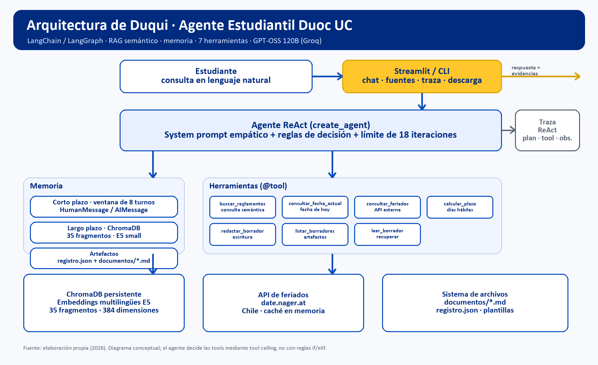

# Informe Técnico: Evolución de un Agente Estudiantil con Memoria y Herramientas

**Autor:** Benjamín Quiroz  
**Asignatura:** ISY0101 — Ingeniería de Soluciones con IA  
**Fecha:** 21 de octubre de 2026

## Resumen Ejecutivo
Este proyecto evoluciona un asistente estudiantil basado en RAG léxico (EP1) hacia un agente funcional ReAct (EP2) integrado con LangChain/LangGraph. El problema central era la baja tolerancia a erratas y la falta de capacidad de decisión del sistema anterior. La solución implementa recuperación semántica (ChromaDB + E5 small), memoria de corto plazo y persistencia de artefactos. El agente orquesta siete herramientas (búsqueda, calendario, redacción) mediante toma de decisiones autónoma (tool calling). Resultados: 22 pruebas automatizadas validadas, manejo de erratas (0.892 relevancia), y capacidad de planificación multi-etapa con trazabilidad completa.

**Palabras clave:** *agente LLM, ReAct, RAG semántico, ChromaDB, memoria conversacional.*

---

## 1. Contexto y Problema
La EP1 utilizaba un enfoque de búsqueda léxica (TF-IDF) que requería coincidencia exacta de términos. Consultas naturales como "asta cuando puedo retirar un ramo" fallaban por erratas o sinónimos ("ramo" vs "asignatura"). Además, el prompt rígido limitaba la interacción a una sola respuesta sin memoria ni capacidad de ejecutar pasos intermedios (ej. calcular plazos).

La evolución hacia un agente ReAct permite que el modelo:
1. **Entienda intención:** Supera las limitaciones léxicas mediante embeddings.
2. **Decida:** Usa herramientas para obtener datos precisos (feriados, plazos) en lugar de alucinar.
3. **Recuerde:** Mantiene el contexto de la conversación y persista borradores.

| Consulta | Resultado EP1 | Mejora EP2 |
|---|---|---|
| `asta cuando puedo retirar un ramo` | Fallo (término desconocido) | **Éxito (0.827 relevancia semántica)** |
| "Hazme el borrador" | No tenía herramienta | **Generación con plantilla y fundamento** |

---

## 2. Arquitectura y Decisiones
El sistema utiliza un grafo ReAct implementado en **LangGraph**, donde el agente (`create_agent`) recibe el estado del historial y un conjunto de herramientas (`@tool`).

### Diagrama de Orquestación

### Justificación de Componentes
- **Framework (LangGraph):** Permite modelar el ciclo de *razón-acto-observación* como un grafo de estados, garantizando la trazabilidad.
- **Modelo (GPT-OSS 120B vía Groq):** Elegido por su equilibrio entre capacidad de razonamiento y latencia para tool calling.
- **Vector Store (ChromaDB):** Permite persistencia local, indexación eficiente de subsecciones y umbrales de relevancia ajustables (0.82).
- **Memoria:** Se implementó una ventana de mensajes (8 turnos) separada del registro de documentos en disco, evitando que el historial contamine el contexto.

---

## 3. Implementación y Planificación
La capacidad de planificar se demuestra en el caso multi-etapa: *Justificar inasistencia y redactar borrador*.

1. **Plan:** El agente identifica la necesidad de buscar el reglamento (`buscar_reglamentos`), calcular la fecha límite (`calcular_plazo`) y finalmente generar el documento (`redactar_borrador`).
2. **Decisión:** El modelo determina el orden de ejecución basándose en las descripciones de los `@tool` sin reglas heurísticas `if/elif`.

La **trazabilidad** es total: la interfaz presenta la traza completa (plan, tool, observación, argumentos JSON) junto a la respuesta final, permitiendo auditar decisiones ante posibles errores.

---

## 4. Pruebas y Resultados
Se validó el sistema con **22 pruebas automatizadas** (`unittest`) que cubren: fragmentación, herramientas, memoria y el flujo E2E del agente.

| Caso | Entrada | Resultado |
|---|---|---|
| Errata semántica | `asta cuando...` | Recuperación (0.827) |
| Asistencia | `asistencia minima...` | Recuperación (0.892) |
| Multi-tool | "Justificar + borrador" | 3 tools, 4 llamadas, archivo OK |
| Fuera de dominio | "Tutorias de surf" | Derivación (No alucinación) |

---

## 5. Limitaciones y Conclusiones
Las principales limitaciones son la dependencia del proveedor del LLM (Groq) para la inferencia, la memoria circunscrita a la sesión actual y la necesidad de revisión humana en los borradores generados.

### Conclusión Técnica
El cambio de arquitectura permitió transformar un buscador frágil en un agente autónomo y auditable. La integración de herramientas y la gestión de memoria fueron los desafíos técnicos principales, superados mediante un flujo ReAct explícito.

### Reflexión Individual (El estudiante debe completar esta sección)
*[El estudiante debe redactar aquí su reflexión personal sobre el aprendizaje obtenido, las dificultades enfrentadas, la decisión técnica que más le costó defender y su contribución específica al trabajo, sin usar IA].*

---

## 6. Referencias (APA 7)
1. LangChain. (2025). *LangChain documentation*.
2. Wang, L. et al. (2024). *Multilingual E5 text embeddings*.
3. Yao, S. et al. (2023). *ReAct: Synergizing reasoning and acting in language models*.
4. Groq. (2025). *Groq API documentation*.
5. Streamlit. (2025). *Streamlit documentation*.

---
*Declaración de uso de IA: Se utilizó IA para apoyo en la estructuración de este informe, depuración del código fuente, generación del diagrama de arquitectura y redacción técnica, validada completamente por el autor. Las conclusiones y reflexiones individuales han sido redactadas íntegramente por el estudiante. Ver pautas en https://bibliotecas.duoc.cl/ia.*
